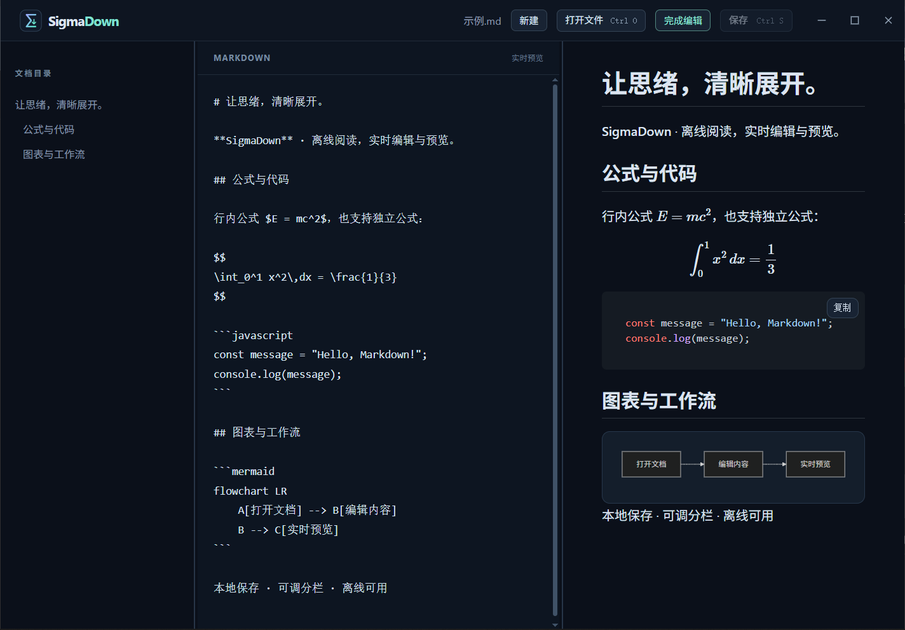

# SigmaDown

一个基于 Tauri 系统 WebView 的深色 Markdown 桌面阅读与编辑应用。渲染方案取自 [fizgrad.github.io 的 Markdown 阅读器](https://github.com/fizgrad/fizgrad.github.io)：Marked、DOMPurify、Highlight.js、MathJax 和 Mermaid。依赖随应用打包，阅读无需联网；公式和 Mermaid 按需加载。应用不会上传文档。

支持分栏编辑、实时预览、Markdown、表格、代码高亮、公式（`$...$`、`$$...$$`、`\\(...\\)`、`\\[...\\]`）、Mermaid 和标题目录。使用“打开文件”或 Ctrl+O（macOS 为 Cmd+O）选择 UTF-8 文件。 拖动目录、编辑区和预览区之间的分隔线可以调整宽度；聚焦分隔线后也可使用左右方向键调整，宽度会自动记住。文件关联启动会打开传入的文档。

## 运行截图

Windows 桌面应用的分栏编辑与实时预览，支持代码高亮、数学公式和 Mermaid 图表。



## 安装与默认打开方式

构建后 Windows 安装包在 `src-tauri/target/release/bundle/` 中。安装后在资源管理器中右键 `.md` 文件，选择“打开方式”→“选择其他应用”→ SigmaDown，勾选“始终使用此应用”。也可在 Windows 设置的“默认应用”中按 `.md` 和 `.markdown` 分别设置。应用注册文件类型，但不会强行更改系统默认程序。

## 开发和打包

需要 Node.js 20、当前稳定版 Rust 以及 [Tauri 2 的平台依赖](https://v2.tauri.app/start/prerequisites/)；Windows 需要 MSVC 构建工具和 WebView2。Linux 需要 WebKitGTK 4.1 开发包。

```sh
npm ci
npm run tauri -- dev
npm run tauri -- build
```

如果 `cargo` 报 `feature edition2024 is required`，说明当前 Rust 工具链过旧。使用 [rustup](https://rustup.rs/) 安装最新稳定版，然后重新打开终端或执行 `. "$HOME/.cargo/env"`，并用 `rustc --version` 和 `cargo --version` 检查版本。已有 rustup 的环境可运行 `rustup update stable`。

在目标平台上构建对应安装包。GitHub Actions 的 `Build desktop apps` 工作流支持手动运行或推送 `v*` 标签，生成 Windows、macOS 和 Linux 构建产物。工作流未配置签名，系统可能提示安装包来自未知发布者。

## 当前限制

这是阅读器，暂不支持拖放、文档相对路径图片或在应用内打开外部链接。新建文件保存时不能覆盖已有文件；保存已有文件会在替换前检查外部修改。对于不配合文件锁的其他程序，最后一次检查和文件替换之间仍存在极短的并发修改窗口。统一使用 CRLF 的文档在编辑保存时保留 CRLF；混合换行文档会统一为 LF。macOS 已运行的应用接收 Finder 后续“打开文件”事件尚未实现，可使用应用内打开。暂未对不同平台的资源占用和启动时间做基准测试。
